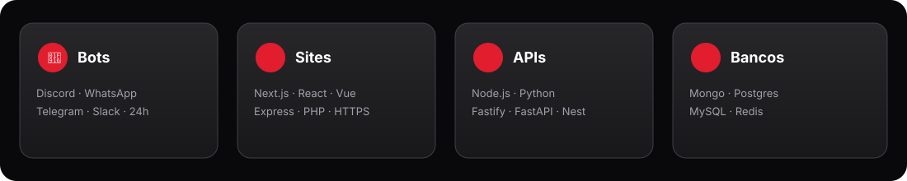

  

  

  <strong>RTCloud</strong> — hospedagem brasileira de <em>bots</em>, <em>sites</em> e <em>APIs</em>. 
  Deploy em minutos · Pix Automático · subdomínios <code>*.rtsystems.app</code>

  
  
  
  
  
  

  

## 🚀 O que é a RTCloud

Plataforma brasileira para hospedar:

  

- **Bots** — Discord, WhatsApp, Telegram e Slack (24h, reinício automático)
- **Sites e lojas** — Next.js, React, Vue, Express, PHP, HTML · HTTPS grátis
- **APIs** — Node.js e Python (Express, Fastify, NestJS, FastAPI, Flask, Django)
- **Bancos dedicados** — MongoDB, PostgreSQL, MySQL, Redis
- **APIs de alto tráfego** — até 16 vCPU / 32 GB (Apex) e Obsidian até 768 GB

## ✨ Recursos em destaque

| Recurso | Detalhe |
|:--|:--|
| Deploy | ZIP ou GitHub · log ao vivo |
| ReactorAI | Explica e corrige erros em português · 1 clique |
| MCP | Claude, ChatGPT, Cursor — operar a hospedagem com autorização |
| Blob Storage | 5 GB–250 GB conforme o plano |
| Pagamento | Pix Automático + recibo em PDF |
| Equipes | Snapshots, domínio por aplicação |

## 💳 Planos (resumo)

| Plano | RAM | Preço/mês |
|:--|:--|:--|
| Teste (grátis, 24h) | 512 MB | — |
| Spark | 1 GB | R$ 16,24 |
| Steel | 2 GB | R$ 32,49 |
| **Carbon** (mais vendido) | 4 GB | **R$ 58,49** |
| … até Apex | 32 GB | R$ 389,87 |
| Obsidian (empresarial) | 48–768 GB | a partir de R$ 584,87 |

> Valores oficiais: **[rtcloud.com.br/planos](https://rtcloud.com.br/planos)**.

<strong>📚 Documentação</strong>

- **Oficial (completa, 90+ artigos):** [docs.rtcloud.com.br](https://docs.rtcloud.com.br)
- **Espelho público (GitHub Pages):** [rtcloud-br.github.io/rtcloud-docs](https://rtcloud-br.github.io/rtcloud-docs/)
- **API pública:** [docs.rtcloud.com.br/referencia-api](https://docs.rtcloud.com.br/referencia-api)
- **Status:** [status.rtcloud.com.br](https://status.rtcloud.com.br)

## 🔗 Links

| | |
|:--|:--|
| Site | https://rtcloud.com.br |
| Docs oficial | https://docs.rtcloud.com.br |
| Docs GitHub | https://rtcloud-br.github.io/rtcloud-docs/ |
| Status | https://status.rtcloud.com.br |
| WhatsApp | https://wa.me/5521998733107 · (21) 99873-3107 |
| E-mail | contato@rtcloud.com.br |
| Discord | https://discord.gg/vbNbKxDR7 |
| Instagram / TikTok | [@rtcloud.br](https://www.instagram.com/rtcloud.br/) |

## 👤 Mantenedor

Construída e mantida por **[RTPySystems](https://github.com/RTPySystems)**.

---

  © RTCloud · <a href="https://rtcloud.com.br">rtcloud.com.br</a> · <code>rtsystems.app</code>

